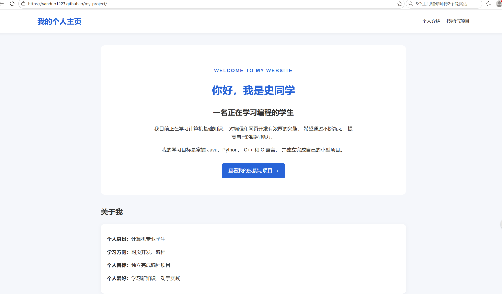
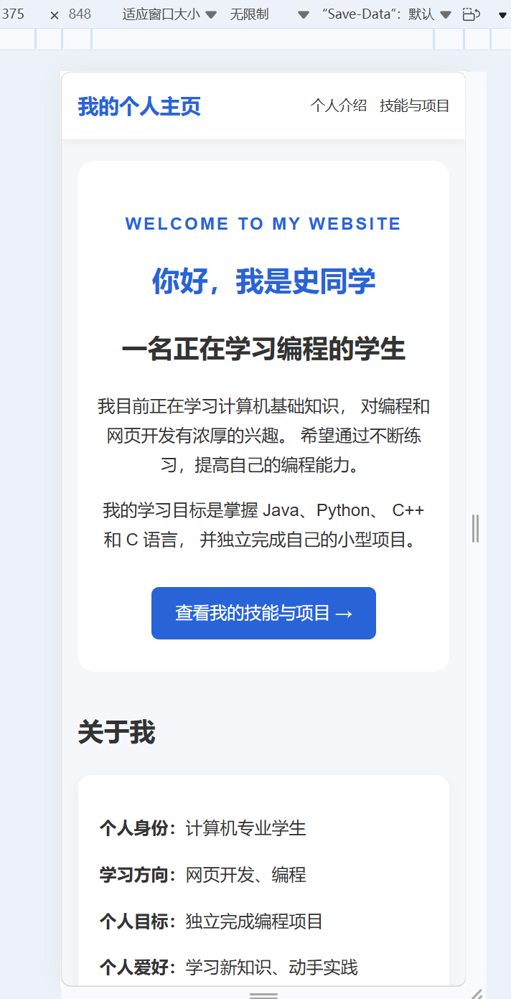
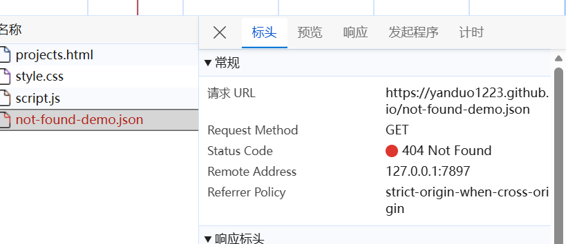

# 史同学的个人主页项目
这是Web前端阶段作业，使用原生 HTML + CSS + JavaScript 开发，满足课程要求。

## 🔗 链接
- **线上预览地址 (Live URL)**: [点击这里查看网页](https://yanduo1223.github.io/my-project/)
- **仓库链接 (Repository)**: [点击这里查看源码](https://github.com/yanduo1223/my-project)

## 🛠️ 本地打开方式
1. 将此仓库下载到本地电脑。
2. 找到并双击 `index.html` 文件。
3. 即可在浏览器中直接预览网页效果。

## 📱 页面展示
### 电脑端截图

### 手机端截图 (375px)

## ✅ 功能&作业要求核对
- 页面数量：≥2个页面，支持页面互相跳转
- 语义化标签：使用 header、nav、main、section、footer
- 响应式：375px手机宽度适配，无横向滚动条、文字不重叠
- JS交互：实现Tab切换 / 表单校验 / 列表筛选（三选一），不是仅hover效果
- 图片：全部压缩，单张小于300KB，控制台无红色报错
- 技术栈：纯原生 HTML/CSS/JS，未使用 Vue、React、Tailwind 等框架

## 📝 抓包记录（F12 Network）
1. 页面主文档 projects.html
   - 请求方法：GET
   - 状态码：200
   - 耗时：1.04s
2. 静态资源 style.css
   - 请求方法：GET
   - 状态码：200
   - 耗时：0ms
3. 自定义 fetch 请求 not-found-demo.json
   - 请求方法：GET
   - 状态码：404
   - 耗时：546ms
> 补充：not-found-demo.json 是故意请求不存在的路径，用来查看404效果

## 📝 学习记录
- 使用了语义化标签（header, nav, main, section, footer）。
- 实现了移动端响应式布局，无横向滚动条。
- 使用 JavaScript 实现了页面交互功能。
